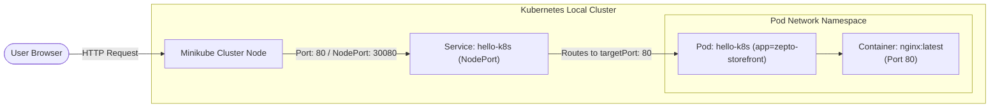

# ⚡ Zepto DevOps Engineering: Kubernetes Hands-On Exercise Series

[](https://kubernetes.io/)
[](https://minikube.sigs.k8s.io/)
[](https://nginx.org/)
[](#exercise-1-hello-pod)

Welcome to **Exercise 1** of the Kubernetes (K8s) Hands-on Series. This repository documents deploying and accessing containerized workloads on Kubernetes from both imperative (quick testing) and declarative (production-grade Infrastructure-as-Code) approaches.

---

## 🏢 Business Scenario (Zepto Quick-Commerce)

> **Scenario**: Imagine you are a DevOps Engineer at **Zepto** (India's leading 10-minute grocery delivery platform).  
> The product engineering team has built a lightweight web app that displays the storefront and live order/delivery tracking status for customers.
>
> **Your Mission**:  
> Deploy this web application on Kubernetes so that it is always running, isolated, portable, and ready to be scaled horizontally across worker nodes. In this foundational exercise, we simulate the storefront frontend using the standard `nginx` container image.

---

## 🎯 Exercise 1: Hello Pod

### Objectives
1. Bootstrap a local Kubernetes cluster using **Minikube**.
2. Deploy the Zepto storefront container as a standalone **Pod** (`hello-k8s`).
3. Verify pod lifecycle states (`Pending` ➔ `ContainerCreating` ➔ `Running`).
4. Expose the container to network traffic using a Kubernetes **Service** of type `NodePort`.
5. Access the application in the web browser and inspect logs/status.

---

## 🏛️ Architecture & Traffic Flow

The following diagram illustrates how incoming client traffic reaches the Zepto storefront Pod through Kubernetes networking:



---

## 📦 Repository Structure

```text
devops/
├── manifests/
│   ├── 01-pod.yaml                      # Declarative Pod manifest (nginx)
│   ├── 02-service.yaml                  # Declarative NodePort Service manifest
│   └── 03-zepto-storefront-custom.yaml  # Bonus: Custom Zepto Storefront & ConfigMap
├── scripts/
│   ├── deploy.ps1                       # One-click deployment script (PowerShell)
│   ├── deploy.sh                        # One-click deployment script (Bash)
│   ├── cleanup.ps1                      # Resource teardown script (PowerShell)
│   └── cleanup.sh                       # Resource teardown script (Bash)
├── .gitignore                           # Git ignore rules
└── README.md                            # Complete lab manual & verification guide
```

---

## ⚙️ Prerequisites & Environment Setup

Before starting, ensure you have **Minikube** and **kubectl** installed with a hypervisor/container runtime (Docker Desktop, Hyper-V, or VirtualBox).

### Installation by OS

<details>
<summary><b>Windows (PowerShell as Administrator)</b></summary>

```powershell
# Option 1: Using winget
winget install Kubernetes.minikube
winget install Kubernetes.kubectl

# Option 2: Using Chocolatey
choco install minikube kubernetes-cli
```
</details>

<details>
<summary><b>macOS (Homebrew)</b></summary>

```bash
brew install minikube
brew install kubectl
```
</details>

<details>
<summary><b>Linux / WSL (Debian/Ubuntu)</b></summary>

```bash
# Update repositories
sudo apt-get update -y && sudo apt-get install -y curl apt-transport-https

# Install Minikube
curl -LO https://storage.googleapis.com/minikube/releases/latest/minikube-linux-amd64
sudo install minikube-linux-amd64 /usr/local/bin/minikube
rm minikube-linux-amd64

# Install kubectl
curl -LO "https://dl.k8s.io/release/$(curl -L -s https://dl.k8s.io/release/stable.txt)/bin/linux/amd64/kubectl"
sudo install -o root -g root -m 0755 kubectl /usr/local/bin/kubectl
rm kubectl
```
</details>

---

## 🚀 Execution Guide

### Method 1: Imperative Commands (Quick CLI Lab)

This follows the exact step-by-step instructions from the coursework:

#### Step 1: Start your local Kubernetes cluster
```bash
minikube start
```
*Expected Output:*
```text
😄  minikube v1.3x on Microsoft Windows
✨  Using the docker driver based on existing profile
👍  Starting control plane node minikube in cluster minikube
🏄  Done! kubectl is now configured to use "minikube" cluster and "default" namespace
```

#### Step 2: Create your first Pod (`hello-k8s`)
```bash
kubectl run hello-k8s --image=nginx --port=80
```
*Output:*
```text
pod/hello-k8s created
```

#### Step 3: Verify the Pod is running
```bash
kubectl get pods
```
*Output:*
```text
NAME        READY   STATUS    RESTARTS   AGE
hello-k8s   1/1     Running   0          18s
```

#### Step 4: Expose the Pod as a Service
Because Pod IP addresses are ephemeral, expose it as a `NodePort` Service to route external traffic:
```bash
kubectl expose pod hello-k8s --type=NodePort --port=80
```
*Output:*
```text
service/hello-k8s exposed
```

#### Step 5: Access the storefront web app
```bash
minikube service hello-k8s
```
This command opens your default web browser pointing directly to the NodePort endpoint (e.g., `http://127.0.0.1:xxxxx`). You will see the **Nginx Welcome / Storefront** web page.

---

### Method 2: Declarative Approach (Production-Ready Manifests)

In real DevOps environments at Zepto, infrastructure is managed declaratively via version-controlled YAML files:

#### 1. Deploy the Pod
```bash
kubectl apply -f manifests/01-pod.yaml
```

#### 2. Deploy the Service
```bash
kubectl apply -f manifests/02-service.yaml
```

#### 3. Verify Cluster State
```bash
# Check Pod status and IP
kubectl get pods -o wide -l app=zepto-storefront

# Check Service details and NodePort mapping
kubectl get svc hello-k8s
```

#### 4. (Bonus) Deploy Branded Zepto Storefront & Delivery Tracker
To simulate the actual Zepto delivery status page instead of default Nginx:
```bash
kubectl apply -f manifests/03-zepto-storefront-custom.yaml
minikube service zepto-custom-pod --url
```

---

## 🔍 Verification & Troubleshooting Commands

If you need to inspect logs or troubleshoot any issues:

| Command | Purpose |
| :--- | :--- |
| `kubectl get pods` | View list of running pods and their statuses |
| `kubectl describe pod hello-k8s` | Detailed event log (useful if status is `ImagePullBackOff` or `Pending`) |
| `kubectl logs hello-k8s` | Stream access and error logs from Nginx container |
| `kubectl get svc hello-k8s` | Inspect service ports and target endpoints |
| `minikube service hello-k8s --url` | Print the accessible external URL without opening browser |

---

## 🧹 Cleanup / Teardown

When you are finished with the exercise, tear down the created resources:

```bash
# Delete the Service
kubectl delete service hello-k8s

# Delete the Pod
kubectl delete pod hello-k8s

# (Optional) Stop Minikube VM/container to free up RAM/CPU
minikube stop
```

Or run the automated cleanup script:
```powershell
# PowerShell
.\scripts\cleanup.ps1

# Bash / Linux / macOS
./scripts/cleanup.sh
```

---

## 📤 Pushing This Repository to GitHub

To submit this work to your instructor and save it in your GitHub profile:

1. **Initialize Git & Commit Files**:
   ```bash
   git init
   git add .
   git commit -m "feat: complete Kubernetes Exercise 1 - Hello Pod (Zepto Storefront)"
   git branch -M main
   ```

2. **Create a New Repository on GitHub**:
   - Go to [GitHub](https://github.com/new).
   - Repository name: `kubernetes-exercises` (or `devops-k8s-exercises`).
   - Leave it public or private as preferred, and do **not** initialize with README (we already created it).

3. **Link Remote and Push**:
   ```bash
   git remote add origin https://github.com/<YOUR_GITHUB_USERNAME>/<YOUR_REPOSITORY_NAME>.git
   git push -u origin main
   ```

---

## 🎓 Key Learnings & Takeaways

- **Pod**: The smallest deployable computing unit in Kubernetes. It encapsulates one or more containers, shared storage, and a unique network IP.
- **Service (`NodePort`)**: Exposes the application on each Node's IP at a static port (`30000-32767`), enabling traffic from outside the cluster to reach the backend pods.
- **Imperative vs. Declarative**: While `kubectl run` is great for quick debugging, YAML manifests stored in Git provide auditability, reproducibility, and GitOps readiness.
